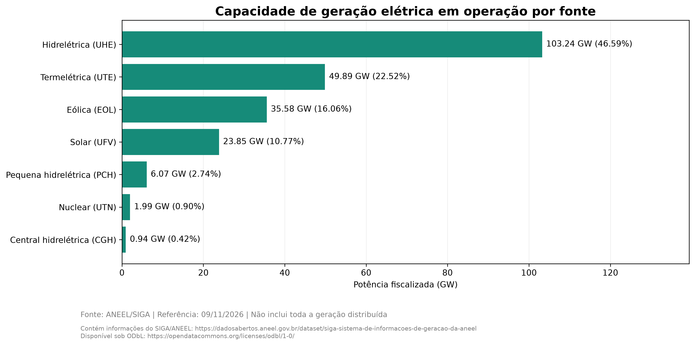
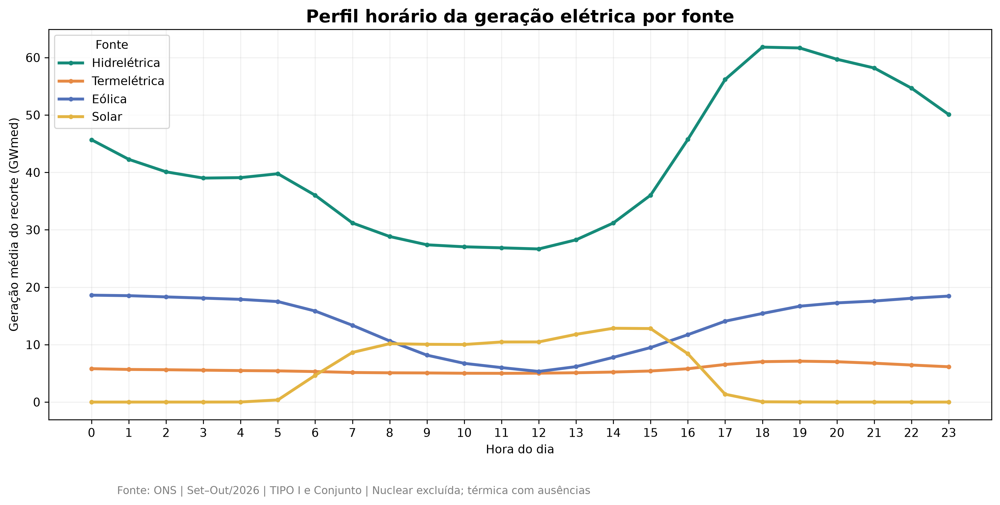
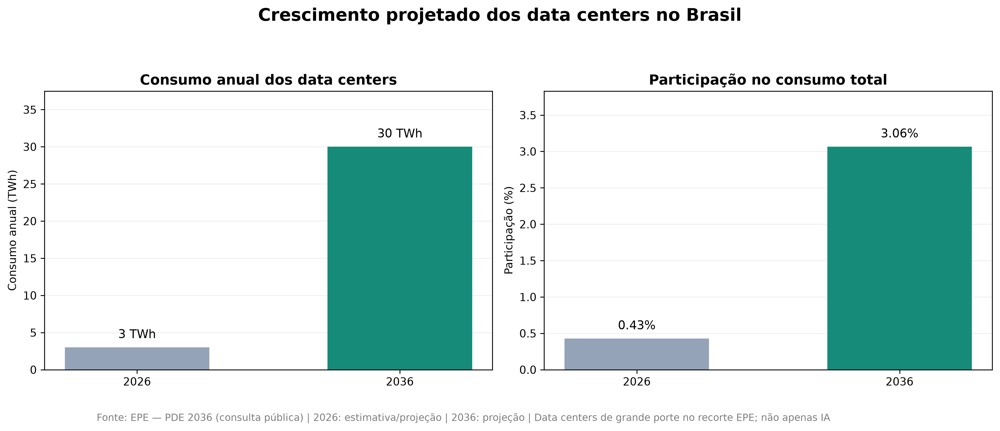
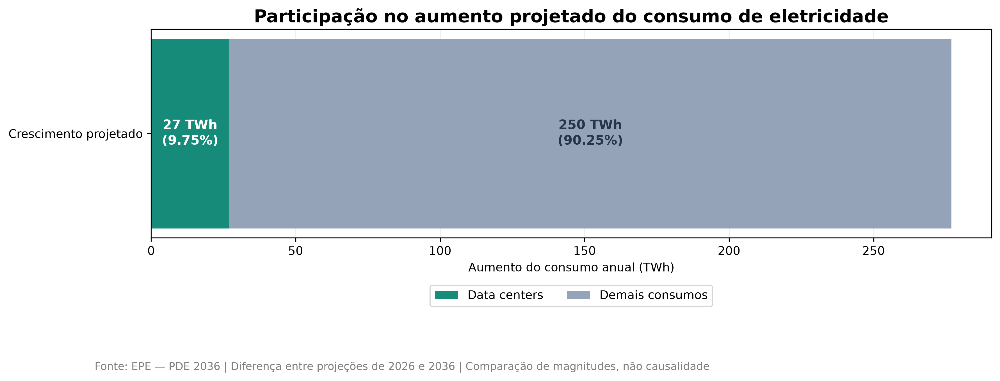
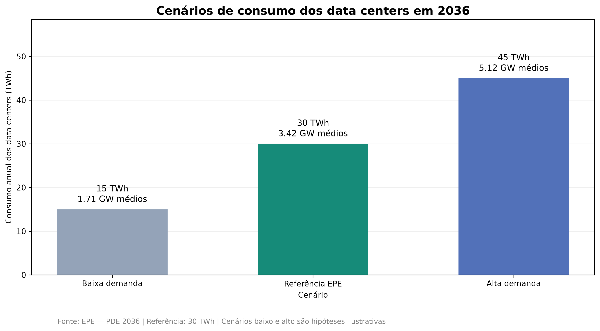
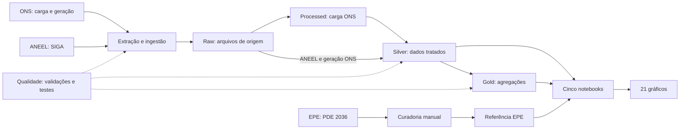

# O Impacto dos Data Centers na Demanda Elétrica Brasileira até 2036: Uma Análise com Dados do ONS, ANEEL e EPE

### Projeções de consumo, carga do SIN e infraestrutura de geração

**Pergunta central:** Qual será a dimensão do crescimento projetado da demanda elétrica dos data centers até 2036 e como esse crescimento se relaciona com a infraestrutura de geração brasileira?

**Objetivo geral:** Analisar a evolução da demanda elétrica brasileira, a infraestrutura de geração cadastrada e as projeções de consumo dos data centers até 2036, quantificando a magnitude do crescimento esperado e discutindo suas implicações para o planejamento energético.

[Repositório no GitHub](https://github.com/gabrielvaz067/impacto-datacenters-energia-brasil)

## 1. Resumo executivo

No cenário de referência da EPE, o consumo anual dos data centers de grande porte abrangidos pelo estudo passa de **3 TWh em 2026 para 30 TWh em 2036**: aumento de **27 TWh/ano**, ou **900%**. Os 30 TWh correspondem a **3,06%** dos 979 TWh de consumo total de eletricidade projetado para 2036. O incremento dos data centers equivale a **9,75%** dos 277 TWh/ano de aumento projetado para o consumo total; é uma comparação de magnitudes, não uma estimativa causal.

A carga média histórica do SIN publicada pelo ONS foi **80,80 GWmed em janeiro–outubro de 2026**, com componentes estimados. Na fotografia ANEEL de 09/11/2026, a potência fiscalizada em operação era **221,56 GW** e havia **93,48 GW** outorgados em projetos não operacionais. Essas grandezas fornecem contexto de escala: capacidade cadastrada não é geração disponível nem garantia de atendimento.

O recorte EPE não se limita à inteligência artificial. A análise não estima adequação elétrica ou capacidade de conexão local; identifica a magnitude projetada e as questões de planejamento que exigem estudos adicionais.

**Em poucos minutos:** ONS fornece carga e geração; ANEEL, o cadastro de capacidade; e EPE, as projeções. O pipeline usa Python, Pandas e PyArrow para percorrer Raw → Processed/Silver → Gold, além de uma referência EPE curada. DuckDB, SQL e Jupyter apoiam a análise. Explore os [notebooks](notebooks/), [pipelines](src/) e [consultas](sql/); execute os [testes e a demonstração sintética](#testes-e-demonstração-sintética-sem-snapshots). A edição histórica é reproduzível com os objetos locais, mas **ainda não está disponível publicamente**; dados atuais podem ser revisados e têm outro recorte. Veja [como executar](#7-como-executar) e [dados e licenças](DADOS_E_LICENCAS.md).

## 2. Principais resultados

### 2.1. Infraestrutura cadastrada

A ANEEL registrou **221,56 GW** fiscalizados em operação e **93,48 GW** outorgados em projetos não operacionais, dos quais **84,64 GW** ainda não haviam iniciado construção. A entrada dos projetos não é garantida.

O gráfico contém informações do [SIGA/ANEEL](https://dadosabertos.aneel.gov.br/dataset/siga-sistema-de-informacoes-de-geracao-da-aneel), disponibilizado sob a [ODbL](https://opendatacommons.org/licenses/odbl/1-0/); os registros foram validados, deduplicados e agregados neste projeto.



### 2.2. Perfil horário selecionado

O recorte ONS de setembro–outubro de 2026 mostra perfis distintos entre as quatro fontes selecionadas; a térmica tem ausências e a nuclear está fora da análise.



A correlação hidrelétrica ajustada pelo dia da semana varia de **0,829 em setembro** para **0,566 em outubro**; a eólica ajustada passa de aproximadamente **−0,057** para **−0,177**. Essa sensibilidade limita generalizações e não identifica causalidade.

### 2.3. Projeção dos data centers

Na referência EPE, 3 TWh em 2026 e 30 TWh em 2036 representam, respectivamente, **0,43% e 3,06%** do consumo total de eletricidade da EPE. O denominador de 3,06% não é a carga do SIN.



### 2.4. Parcela do crescimento projetado

O incremento de **27 TWh/ano** no recorte de data centers corresponde a **9,75%** do aumento projetado de **277 TWh/ano** no consumo total entre 2026 e 2036.



### 2.5. Sensibilidade para 2036

| Cenário | Consumo anual | Potência média equivalente civil |
|---|---:|---:|
| Baixa demanda | 15 TWh | 1,71 GWmed |
| Referência EPE | 30 TWh | 3,42 GWmed |
| Alta demanda | 45 TWh | 5,12 GWmed |



## 3. Arquitetura e tecnologias



As extrações consultam as fontes públicas; a curadoria EPE é definida manualmente e gerada pelo script do projeto. As validações acompanham a ingestão e as transformações. As camadas de dados são geradas localmente e não integram o repositório público.

### Tecnologias utilizadas

Python, Pandas, PyArrow/Parquet, DuckDB, Matplotlib, Requests e Jupyter. As camadas Raw, Processed, Silver e Gold organizam a extração, validação e agregação; os dados EPE são uma referência curada manualmente.

## 4. Fontes e rastreabilidade

| Fonte | Evidência e utilização |
|---|---|
| [ONS — carga diária](https://dados.ons.org.br/dataset/carga-energia) | Série histórica diária dos quatro subsistemas em MWmed, com dados operacionais e componentes estimados. |
| [ONS — geração horária](https://dados.ons.org.br/dataset/geracao-usina-2) | Geração por usina e conjunto; análise selecionada de setembro–outubro de 2026. |
| [ANEEL — SIGA](https://dadosabertos.aneel.gov.br/dataset/siga-sistema-de-informacoes-de-geracao-da-aneel) | Fotografia cadastral de 09/11/2026: potência fiscalizada e outorgada. |
| EPE — PDE 2036, consulta pública | Curadoria manual de estimativas e projeções, separada da ingestão automatizada de ONS e ANEEL. |

As séries ONS são identificadas nos catálogos como CC BY; a versão específica requer confirmação. O SIGA ANEEL é identificado como ODbL. O rodapé da [página oficial do PDE 2036](https://epe.gov.br/pt/publicacoes-dados-abertos/publicacoes/plano-decenal-de-expansao-de-energia-2036) indica [CC BY 4.0](https://creativecommons.org/licenses/by/4.0/) para o conteúdo do site; direitos de eventuais materiais de terceiros e o alcance nos documentos específicos exigem verificação. As atribuições, alterações e questões pendentes estão em [Dados e licenças](DADOS_E_LICENCAS.md).

**Atribuições e alterações:** dados de [carga](https://dados.ons.org.br/dataset/carga-energia) e [geração](https://dados.ons.org.br/dataset/geracao-usina-2) do ONS foram validados, selecionados e agregados; as séries incluem componentes estimados. Os resultados de capacidade contêm informações do [SIGA/ANEEL](https://dadosabertos.aneel.gov.br/dataset/siga-sistema-de-informacoes-de-geracao-da-aneel), disponibilizadas sob a [ODbL](https://opendatacommons.org/licenses/odbl/1-0/), e foram validados, deduplicados e agregados. Os valores EPE foram selecionados manualmente do PDE 2036 e os percentuais, conversões e cenários foram calculados pelo projeto. As condições de acesso à base derivada ANEEL ou ao método de alteração, quando aplicáveis, exigem a avaliação descrita em [Dados e licenças](DADOS_E_LICENCAS.md).

O [método de transformação SIGA](METODO_TRANSFORMACAO_SIGA.md) detalha regras, código, agregações e limitações de reprodução; a disponibilidade do método não implica a disponibilidade da fotografia histórica.

O código Python, as consultas SQL e os testes **autorais** deste projeto são licenciados sob a [MIT](LICENSE), copyright © 2026 Gabriel Gomes Vaz. Essa licença não abrange automaticamente datasets ONS/ANEEL/EPE, documentos de terceiros, outputs de notebooks, gráficos ou outros conteúdos com direitos próprios; dependências externas mantêm suas respectivas licenças. Valores e referências de fontes incorporados ao código também permanecem sujeitos às condições aplicáveis às fontes.

Na EPE, a [Tabela 2-4 do Relatório Síntese, p. 59](https://www.epe.gov.br/sites-pt/publicacoes-dados-abertos/publicacoes/PublicacoesArquivos/publicacao-982/topico-860/PDE%202036_Relat%C3%B3rio%20S%C3%ADntese_rev3_2026-10-08.pdf#page=59) apresenta 702/979 TWh de consumo total; a Figura 2-12, p. 60, apresenta o recorte de grandes cargas. O [Caderno de Demanda de Energia](https://www.epe.gov.br/sites-pt/publicacoes-dados-abertos/publicacoes/PublicacoesArquivos/publicacao-982/topico-851/PDE%202036_Caderno%20de%20Demanda%20de%20Energia_v1_2026-10-27.pdf) traz o perímetro do consumo total na p. 11 e o contexto dos data centers na p. 36. A verificação das referências foi realizada em 10/11/2026; não se atribui essa data à consulta histórica original. O CSV de curadoria registra documento, versão, páginas, definição, perímetro e natureza dos dados.

## 5. Metodologia

### 5.1. Carga e capacidade

A série histórica de carga publicada pelo ONS combina dados operacionais e componentes estimados, incluindo previsão de geração de pequenas usinas e, desde 29/04/2023, MMGD estimada. Ela não é diretamente equivalente ao consumo total de eletricidade da EPE, que inclui autoprodução não injetada e consumo interno das usinas. Para o agregado nacional, somam-se os quatro subsistemas; médias entre períodos são ponderadas pela duração. Meses incompletos são identificados e excluídos das comparações mensais completas.

A ANEEL fornece uma fotografia cadastral. Empreendimentos com CEG redundante são deduplicados apenas após conferir atributos essenciais; potência fiscalizada operacional e potência outorgada de projetos são apresentadas separadamente.

### 5.2. Geração horária e estatística

Em setembro–outubro de 2026, os gráficos e correlações usam TIPO I e Conjunto de Usinas nas fontes hidrelétrica, térmica, eólica e solar. O ONS informa que conjuntos reúnem usinas Tipo II-C e grupos de pequenas usinas Tipo III têm geração prevista; o recorte evita somar conjuntamente modalidades individuais excluídas e seus conjuntos, sem comprovar por si só ausência de sobreposição. II-A, II-B, II-C individuais, Tipo III e MMGD ficam fora, assim como a nuclear. O recorte não é a geração nacional completa nem um balanço energético.

Existem 1.464 registros térmicos ausentes no recorte analisado. A soma térmica representa os valores disponíveis; percentual de preenchimento não comprova completude do universo de geração. Nulos e negativos são preservados e sinalizados, sem atribuir causa aos negativos.

As correlações de Pearson são exploratórias. O ajuste por dia da semana remove a média de cada dia da semana das séries antes de correlacionar os resíduos; não controla clima, tendência, despacho ou feriados. As amostras de 30, 31 e 61 dias podem ter dependência temporal e variáveis omitidas. Os resultados não estabelecem causalidade ou significância estatística. Segunda–sexta não é identificada como dia útil, pois não há calendário de feriados.

### 5.3. Energia anual e cenários

Potência média equivalente é energia anual dividida pelas horas do ano civil: **8.760 em 2026** e **8.784 em 2036**. Assim, 30 TWh/ano em 2036 equivalem a aproximadamente **3,4153 GWmed**, não a potência de pico. O Caderno da EPE também emprega uma conversão convencional de 8.760 horas: ela serve para reproduzir aquela convenção, enquanto este projeto usa o ano civil. Os cenários de 15 e 45 TWh são hipóteses ilustrativas, não projeções adicionais da EPE.

## 6. Estrutura do projeto

`data/` contém insumos, referências e camadas analíticas; `src/` contém extrações, transformações e ferramentas de edição; `notebooks/` contém cinco análises; `sql/` reúne consultas; `images/` contém 21 figuras; `edicoes/` registra manifestos e `tests/` contém a suíte automatizada. Os datasets históricos, snapshots privados e pacotes não são distribuídos no repositório público.

## 7. Como executar

Ambiente validado: **Python 3.14.7 no Windows**. Execute os comandos abaixo a partir da raiz do projeto. O `requirements.txt` inclui DuckDB para os notebooks e `tzdata` para os fusos horários IANA usados por `zoneinfo` no Windows.

Crie o ambiente virtual e instale as dependências (PowerShell):

```powershell
py -3.14 -m venv .venv
.\.venv\Scripts\Activate.ps1
python -m pip install -r requirements.txt
```

Em Linux/macOS, use `python3.14 -m venv .venv` e `source .venv/bin/activate`. Se a política do PowerShell impedir a ativação, utilize `.\.venv\Scripts\python.exe` no lugar de `python`, sem alterar a política do sistema.

O repositório público contém código, cinco notebooks, 21 gráficos, testes e documentação. Raw, Processed, Silver, Gold, a referência local, controles operacionais, snapshots privados e pacotes históricos não são distribuídos no repositório e são ignorados pelo Git. Para recriar localmente a referência EPE curada, execute `python src/ingestao_epe.py`. Ela contém indicadores dos documentos oficiais e permanece sujeita à revisão de uso descrita em [Dados e licenças](DADOS_E_LICENCAS.md).

### Testes e demonstração sintética sem snapshots

Na raiz, após instalar as dependências, execute a suíte sem rede:

```bash
python -m unittest discover -s tests -v
```

A regressão da fotografia histórica é **opcional e explicitamente pulada por padrão**, mesmo quando arquivos locais existem; os demais testes são executados. Para executá-la, disponha dos três CSVs de carga históricos em `data/raw/` e do manifesto confiável `edicoes/2026-11-09.json`. O teste confere os SHA-256 antes dos indicadores e falha se os arquivos estiverem ausentes ou forem versões diferentes. Dados atuais revisados não substituem o snapshot. No PowerShell:

```powershell
$env:EXECUTAR_REGRESSAO_HISTORICA = '1'
python -m unittest discover -s tests -p test_extracao_ons.py -k test_regressao_snapshot_auditado_2024_2026 -v
Remove-Item Env:EXECUTAR_REGRESSAO_HISTORICA
```

Em Linux/macOS, prefixe o mesmo comando com `EXECUTAR_REGRESSAO_HISTORICA=1`. Para uma demonstração pequena, sem rede e sem dados históricos privados:

```bash
python -m unittest discover -s tests -p test_extracao_ons.py -k test_pipeline_sintetico_com_mes_incompleto_e_cli_da_raiz -v
```

O teste cria respostas HTTP simuladas e dados **sintéticos** de dois dias e quatro subsistemas em pasta temporária, executa Raw → Processed → Silver → Gold, verifica mês incompleto e reexecução idempotente e descarta os arquivos temporários. Os valores são apenas de teste, não dados oficiais nem substitutos dos indicadores históricos.

### Executar com dados públicos atuais

Use uma cópia de trabalho nova, com `data/` vazio e espaço para downloads, a partir da raiz. Estes comandos consultam os catálogos e recursos atuais do ONS e da ANEEL; exigem rede e dependem da disponibilidade, estrutura e períodos oferecidos pelas fontes. Ajuste os anos e competências ao período desejado e só avance se cada comando terminar com sucesso:

```bash
python src/extracao_ons.py --anos 2024 2025 2026
python src/extracao_aneel.py --atualizar
python src/extracao_geracao_ons.py --inicio 2026-09 --fim 2026-11
python src/transformacao_ons.py
python src/transformacao_aneel.py
python src/transformacao_geracao_ons.py --inicio 2026-09 --fim 2026-11
python src/ingestao_epe.py
```

A EPE é uma curadoria manual fixa dos documentos de 2026, não um download ou atualização automática. As extrações atuais podem conter revisões, meses parciais ou períodos indisponíveis; resultados e gráficos podem diferir da fotografia histórica. Os notebooks têm recortes analíticos específicos: confira os períodos necessários antes de executá-los na ordem 01–05 pela raiz com `python -m notebook`. O notebook 05 gera a síntese. Essa execução não cria nem recupera uma edição histórica.

<details>
<summary>Operações históricas e avançadas</summary>

### Reproduzir a edição histórica local

A edição `2026-11-09` está definida em `edicoes/2026-11-09.json`, com o recorte de `config/edicao_2026-11-09.json`: carga de 2024–2026 até 06/11/2026; geração de setembro/outubro e novembro parcial até 08/11; fotografia ANEEL de 09/11/2026; CSV EPE da consulta pública de 2026. Os bytes preservados, incluindo scripts, notebooks, SQL e dependências declaradas, ficam em `data/snapshots/sha256/`, fora do Git.

**Pacote histórico privado:** o pacote histórico não é distribuído no repositório público. Um clone sem os snapshots não reproduz a edição sozinho. O manifesto permite conferir o pacote quando ele for disponibilizado; baixar os arquivos atuais das fontes não recupera necessariamente a fotografia antiga.

A edição `2026-11-09` preserva os dados, scripts e notebooks daquela fotografia. Seu notebook 02 divide a energia projetada de 2036 por **8.760 horas**; a versão analítica atual usa **8.784 horas**, correspondentes ao ano civil bissexto. Reproduzir a edição histórica não é reproduzir identicamente a versão editorial atual. Para uma futura edição atualizada, defina outro identificador, preserve seus insumos e código, gere manifesto e hashes próprios e valide os resultados; não substitua nem altere a edição de 2026-11-09. Esse procedimento não cria uma nova edição automaticamente.

Com o armazenamento local disponível:

```bash
python src/edicoes.py verificar --manifesto edicoes/2026-11-09.json
python src/edicoes.py reproduzir --manifesto edicoes/2026-11-09.json --destino execucoes/publicada-2026-11-09
```

A reprodução é offline: verifica tamanho e SHA-256 de todos os objetos, restaura os insumos e o código preservado e executa Raw → Processed/Silver → Gold na pasta escolhida. O CSV EPE é restaurado, sem refazer a curadoria. As transformações continuam com seus contratos originais. Não execute a transformação da raiz esperando que ela leia outra pasta de dados.

Depois, no ambiente virtual ativado, abra os notebooks da reprodução e execute-os em ordem numérica:

```powershell
Push-Location execucoes/publicada-2026-11-09
python -m notebook
Pop-Location
```

Inicie os notebooks na raiz da reprodução ou em sua subpasta `notebooks/`. A síntese final é gerada pelo notebook 05. Uma reexecução sobre insumos intactos é idempotente. Se salvar alterações nos notebooks, inclusive outputs do Jupyter, use uma nova pasta de destino para restaurar novamente os arquivos exatos. Os objetos históricos não são alterados.

Para reutilizar somente a fotografia ANEEL, sem rede, em uma pasta vazia:

```bash
python src/extracao_aneel.py --snapshot 2026-11-09 --data-dir execucoes/aneel-historica/data
```

### Atualizar os dados e criar outra edição

Use uma área operacional separada e avance somente se cada comando terminar com sucesso. O exemplo reconsulta o período do estudo; revisões da fonte podem produzir valores diferentes. Para outro período, ajuste os argumentos, sem editar os notebooks históricos.

```powershell
New-Item -ItemType Directory -Path execucoes/atualizacao-01/data/reference -ErrorAction Stop
Copy-Item data/reference/epe_pde2036.csv execucoes/atualizacao-01/data/reference/
python src/extracao_ons.py --anos 2024 2025 2026 --data-dir execucoes/atualizacao-01/data
python src/extracao_aneel.py --atualizar --data-dir execucoes/atualizacao-01/data
python src/extracao_geracao_ons.py --inicio 2026-09 --fim 2026-11 --data-dir execucoes/atualizacao-01/data
python src/edicoes.py comparar --manifesto edicoes/2026-11-09.json --dados-atuais execucoes/atualizacao-01/data
python src/edicoes.py preservar --edicao revisao-local-01 --origem execucoes/atualizacao-01
python src/edicoes.py reproduzir --manifesto edicoes/revisao-local-01.json --destino execucoes/revisao-local-01
```

O comando `comparar` verifica diferenças de conteúdo local contra a edição; não consulta o catálogo e não atribui automaticamente toda divergência a uma revisão legítima. O comando `preservar` registra as referências efetivamente encontradas nos arquivos, sem reaplicar os rótulos antigos. A referência EPE continua sendo a curadoria de 2026. Uma nova edição de dados não atualiza automaticamente os títulos e recortes fixos dos notebooks publicados; a análise de outra fotografia exige revisão própria.

Para atualização operacional dos três recursos mensais mais recentes, use, alternativamente:

```bash
python src/extracao_geracao_ons.py --recentes 3 --data-dir execucoes/operacional/data
```

`--recentes` é incompatível com `--inicio/--fim`. Um intervalo indisponível falha explicitamente; não há conversão automática dos recursos anuais anteriores ao histórico mensal do catálogo. Selecionar competências antigas na API obtém a versão corrente desses meses, não os bytes da edição histórica.

O controle incremental da carga mantém ETag/Last-Modified e SHA-256, a recuperação dos intermediários e as validações da etapa 1. `--anos` seleciona anos para atualização, sem remover outros arquivos. ANEEL e geração mantêm seus controles operacionais. Os extratores recusam gravação no armazenamento de snapshots e nas pastas de reprodução identificadas pelo manifesto. Uma edição já preservada não pode ser substituída: uma revisão exige outro identificador.

Na primeira atualização de um controle legado sem SHA-256 local, o extrator baixa novamente o recurso sem condicionais e registra seu hash; sem rede ou com download inválido, a execução falha preservando os arquivos existentes. Nas reexecuções, o cache passa por validação de formato, tamanho e hash antes do reuso. Um HTTP 304 recebido sem cache íntegro provoca uma tentativa sem condicionais; outro 304 falha. Para reprodução histórica offline, use o fluxo de snapshots acima.

Os extratores fazem até três tentativas para falhas transitórias de conexão, timeout, interrupção de transferência e HTTP 429, 500, 502, 503 ou 504. O intervalo cresce de 0,5 para 1 segundo; `Retry-After` válido é respeitado até o limite de 30 segundos. Se o servidor solicitar espera maior, a operação falha sem antecipar a tentativa. Erros permanentes como 400, 401, 403 e 404 e erros de certificado TLS não são repetidos; a verificação TLS permanece habilitada. Em uma transferência interrompida, o arquivo temporário é descartado antes de reiniciar. A validação de integridade e a preservação de arquivos e controles continuam obrigatórias.

`src/consulta_geracao_ons.py` é um utilitário exploratório do catálogo, não uma etapa de ingestão. O diretório local `dashboard/` está vazio e não representa uma funcionalidade entregue.

### Preservação, transporte e integridade

O manifesto registra versão do formato, edição, origem/recurso, referência, aquisição quando conhecida, caminho relativo, bytes e SHA-256. ETag e metadados do controle local são observações separadas do conteúdo preservado. Aquisições antigas não registradas ficam explicitamente desconhecidas; `Last-Modified` e `verificado_em` não são convertidos em datas de aquisição.

Para preservar a edição histórica a partir dos arquivos locais originais, o comando utilizado foi:

```bash
python src/edicoes.py preservar --edicao 2026-11-09 --config config/edicao_2026-11-09.json
```

Esse comando não recupera arquivos antigos perdidos e recusa conteúdos diferentes para uma edição existente. A integridade é verificada pelos hashes dos bytes, não somente por ETag. O armazenamento usa cópias independentes, sem sobrescrita pelas ferramentas; não é um serviço WORM nem impede alterações manuais no disco. Preserve também uma cópia externa do pacote.

**Verificar e importar um pacote existente.** O comando `verificar` confere objetos no armazenamento, não abre o ZIP. Para verificar o ZIP existente contra um manifesto obtido separadamente por canal confiável, importe-o para um armazenamento vazio e depois confira os objetos importados. Os exemplos usam diretórios novos; ajuste os caminhos para uma área de trabalho apropriada. O pacote precisa estar disponível localmente e sua distribuição depende das condições descritas em [Dados e licenças](DADOS_E_LICENCAS.md).

```powershell
New-Item -ItemType Directory -Path execucoes/objetos-importados -ErrorAction Stop
python src/edicoes.py importar --manifesto edicoes/2026-11-09.json --pacote pacotes/2026-11-09.zip --armazenamento execucoes/objetos-importados
python src/edicoes.py verificar --manifesto edicoes/2026-11-09.json --armazenamento execucoes/objetos-importados
```

**Exportar para um novo nome.** Com todos os objetos já disponíveis e íntegros no armazenamento escolhido, use um caminho ainda inexistente; a ferramenta recusa sobrescrever ZIPs. Altere o nome em uma reexecução:

```powershell
New-Item -ItemType Directory -Force pacotes
python src/edicoes.py exportar --manifesto edicoes/2026-11-09.json --armazenamento execucoes/objetos-importados --pacote pacotes/2026-11-09-copia-local.zip
```

Se os objetos históricos não estiverem no armazenamento, recupere-os por um pacote ou cópia autorizada e verificável quando disponível; consultar os portais atuais não garante recuperar os bytes antigos. `--armazenamento CAMINHO` escolhe o repositório de objetos. O ZIP inclui o manifesto e os objetos por hash; a importação exige igualdade com o manifesto fornecido separadamente e verifica todos os objetos. `data/snapshots/`, `pacotes/` e `execucoes/` são ignorados pelo Git. O pacote histórico local contém insumos de terceiros e notebooks arquivados com caminhos pessoais; sua distribuição ainda requer revisão. Esses comandos não publicam nem enviam o pacote automaticamente.

Testes automatizados offline, sempre em diretórios temporários:

```bash
python -m unittest discover -s tests -v
```

### Publicação e qualidade das transformações

Cada transformação publica uma execução separada em `data/.publicacoes/`: `carga_ons`, `aneel` e `geracao_ons`. A curadoria `epe` e a síntese do notebook 05 também têm publicações próprias. Cada execução recebe identificador, arquivos versionados e manifesto com hashes e diagnóstico; o ponteiro `atual.json` só é substituído após validar e promover todos os arquivos do domínio. A primeira execução da versão atual cria esse ponteiro; tabelas antigas existentes, por si só, não constituem uma publicação versionada.

Para ler várias tabelas coerentes do **mesmo domínio**, fixe uma única versão pelo leitor, que confere os hashes, e use os caminhos retornados:

```python
from pathlib import Path
from src.publicacao import ler_concluida
import pandas as pd

manifesto, arquivos = ler_concluida(Path.cwd(), "carga_ons")
silver = pd.read_parquet(arquivos["data/silver/carga_energia.parquet"])
gold = pd.read_parquet(arquivos["data/gold/carga_mensal.parquet"])
print(manifesto["id"], manifesto["qualidade"])
```

Os caminhos tradicionais em `data/silver/`, `data/gold/` e `data/reference/` são cópias de compatibilidade. Durante a promoção, ou após interrupção até a próxima execução do mesmo domínio, uma leitura direta desses caminhos pode misturar versões. A reexecução recupera a transação pendente antes de começar; um bloqueio do sistema operacional impede escritores simultâneos do mesmo domínio. O contrato de versão vale por domínio: não existe transação global entre ONS, ANEEL, EPE e síntese, e os notebooks que usam caminhos tradicionais devem ser executados sem publicações concorrentes. As execuções locais não são edições históricas; a pasta é ignorada pelo Git e suas versões concluídas não são apagadas automaticamente.

Na carga, chaves duplicadas, datas internas faltantes, carga inválida e ausência de qualquer um dos quatro subsistemas em um dia bloqueiam a publicação. Meses parciais são sinalizados na Gold e no manifesto. O intervalo coberto é o efetivamente recebido, não uma comprovação de cobertura de um período externo não informado.

Na geração, competências ausentes dentro do intervalo, duplicadas ou divergentes do nome, instantes fora da hora e lacunas internas no calendário horário global bloqueiam a publicação. Para exigir competências específicas, use, por exemplo:

```bash
python src/transformacao_geracao_ons.py --inicio 2026-09 --fim 2026-11
```

O manifesto distingue competências parciais, horas recebidas, preenchimento, entidades com horas ausentes e entradas/saídas entre meses; estes casos geram alertas, pois o universo pode mudar legitimamente. Cobertura de valores recebidos não prova que todas as usinas esperadas foram recebidas, e não se presume que cada combinação de fonte e subsistema exista. A ANEEL continua rejeitando CEGs conflitantes e fases ou potências obrigatórias inválidas. Nenhum valor ausente é imputado.

A recuperação destina-se a interrupções de processo e falhas de escrita em sistema de arquivos local; não promete transação entre domínios nem durabilidade universal em quedas de energia ou sistemas de arquivos de rede. A edição histórica continua usando seus próprios arquivos e código preservados.

As limitações de acesso e reprodução estão descritas em [Dados e licenças](DADOS_E_LICENCAS.md).

</details>

## 8. Limitações

- As projeções EPE são condicionadas a premissas e tratam o recorte de grandes cargas/data centers de grande porte, não exclusivamente IA.
- A carga ONS inclui estimativas e não possui o mesmo perímetro que o consumo total EPE.
- A capacidade ANEEL é cadastral; geração disponível, perdas, restrições de transmissão, distribuição e conexão local não são modeladas.
- Projetos não operacionais não têm entrada em serviço garantida.
- Geração e correlações cobrem setembro–outubro de 2026, com nuclear excluída, térmica incompleta e universo de usinas não certificado.
- Há dependência temporal potencial, variáveis omitidas e ausência de identificação causal ou teste de significância.
- Os cenários alternativos são hipóteses ilustrativas, não estudo de adequação.
- O pacote histórico não é distribuído publicamente; um caminho local não o torna acessível a terceiros.

## 9. Conclusão

Segundo a referência EPE, o crescimento dos data centers de grande porte analisados é de **27 TWh/ano** entre 2026 e 2036, chegando a **30 TWh/ano**, ou **3,06%** do consumo total projetado. O acréscimo corresponde a **9,75%** do aumento projetado do consumo total e a energia de 2036 equivale a **3,4153 GWmed** no calendário civil.

A comparação com **221,56 GW** de potência fiscalizada em operação, **93,48 GW** de projetos não operacionais e a carga histórica de **80,80 GWmed** dimensiona as ordens de grandeza, mas não permite subtrair capacidade, potência média e consumo como se tivessem o mesmo perímetro ou disponibilidade. As diferenças horárias entre fontes e as lacunas de dados reforçam a necessidade de avaliar onde e quando a demanda ocorre, além da disponibilidade, flexibilidade e infraestrutura de conexão. Esta análise responde à pergunta de magnitude e relação com a infraestrutura cadastrada; a suficiência do sistema exige estudo específico de adequação.

## 10. Autor

**Gabriel Gomes Vaz**

Projeto de portfólio em Engenharia de Dados, Business Intelligence e Analytics.

[GitHub](https://github.com/gabrielvaz067)
