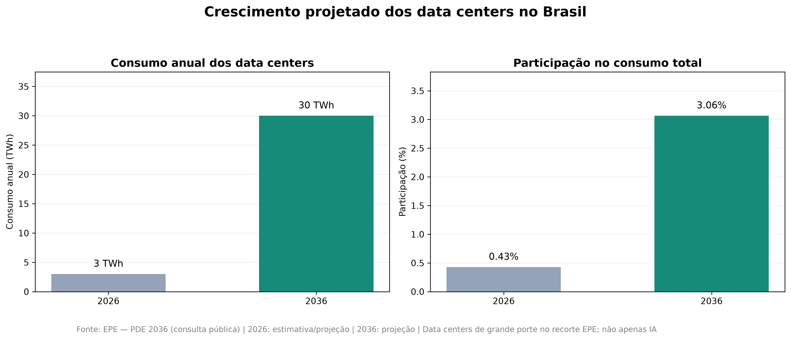
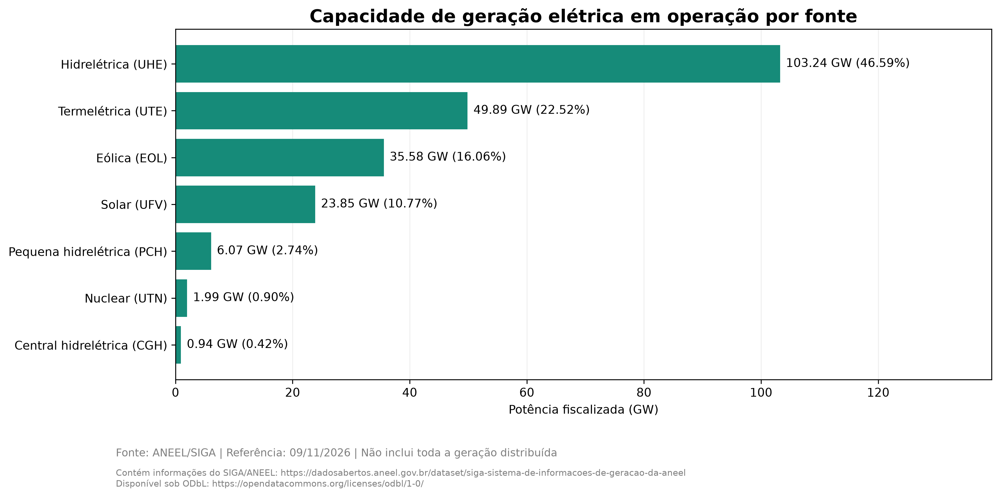
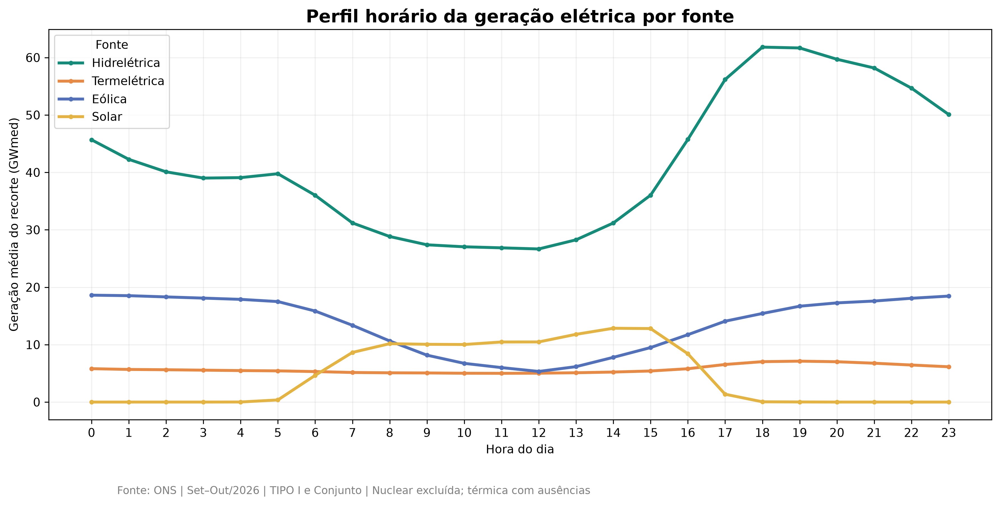
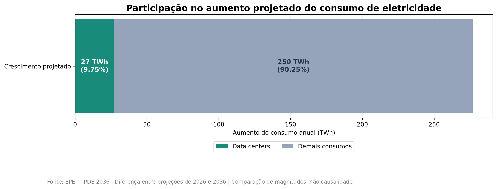
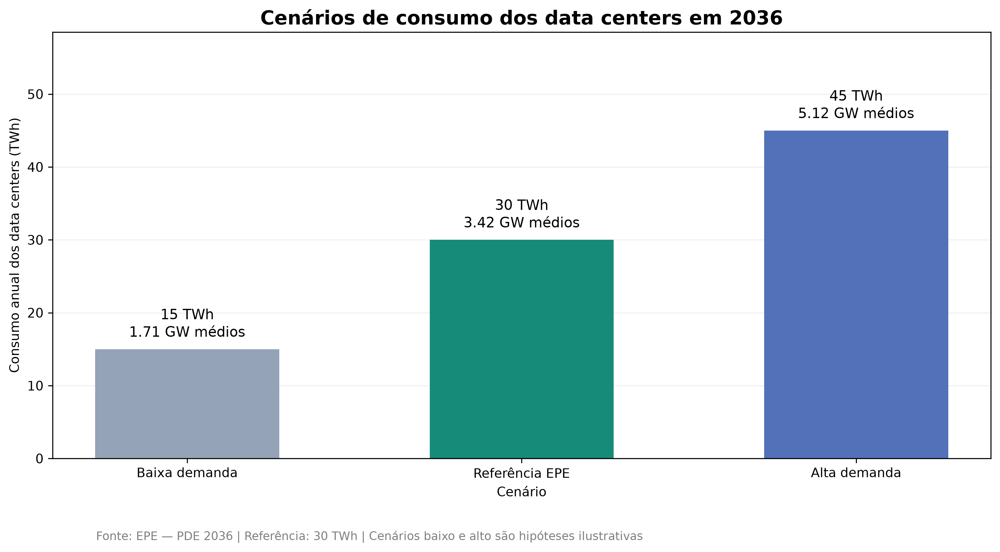

# Data centers e energia no Brasil: o que esperar até 2036?

### Uma análise de dados públicos do ONS, da ANEEL e da EPE

O crescimento da inteligência artificial e dos serviços digitais também traz uma pergunta sobre infraestrutura: quanta energia será necessária para sustentar a expansão dos data centers no Brasil?

Neste projeto, analisei dados públicos para entender três pontos: como a carga elétrica brasileira evoluiu, qual é a dimensão da infraestrutura de geração cadastrada e o que as projeções indicam para o consumo dos data centers até 2036.

A ideia não é prever se faltará energia, mas **colocar os números em perspectiva** e identificar o que eles ajudam — e o que não ajudam — a responder.

## O principal resultado

No cenário de referência da Empresa de Pesquisa Energética (EPE), o consumo anual dos data centers de grande porte considerados no estudo passa de **3 TWh em 2026 para 30 TWh em 2036**. São **27 TWh adicionais por ano**, um crescimento de **900%**.

Em 2036, esses 30 TWh representariam **3,06%** do consumo total de eletricidade projetado pela EPE. Olhando somente para o *aumento* previsto no consumo brasileiro entre 2026 e 2036, o acréscimo associado aos data centers equivale a **9,75%** desse crescimento.

Esses percentuais comparam projeções de um mesmo estudo. Não indicam que os data centers causariam essa parcela do crescimento de outros setores, nem representam uma previsão exclusiva para aplicações de IA.

## Como cheguei a esses números

Cruzei três fontes que respondem a perguntas diferentes:

| Fonte | O que procurei entender |
| --- | --- |
| [ONS — carga diária](https://dados.ons.org.br/dataset/carga-energia) | Como a carga do Sistema Interligado Nacional (SIN) evoluiu ao longo do tempo |
| [ONS — geração por usina](https://dados.ons.org.br/dataset/geracao-usina-2) | Como se comportaram, em um recorte horário, as fontes hidrelétrica, térmica, eólica e solar |
| [ANEEL — SIGA](https://dadosabertos.aneel.gov.br/dataset/siga-sistema-de-informacoes-de-geracao-da-aneel) | Qual a potência fiscalizada em operação e a capacidade outorgada em projetos |
| [EPE — PDE 2036](https://epe.gov.br/pt/publicacoes-dados-abertos/publicacoes/plano-decenal-de-expansao-de-energia-2036) | Qual o consumo de eletricidade projetado, inclusive para grandes cargas e data centers |

Para organizar a análise, preparei um fluxo de extração e tratamento com **Python, Pandas e arquivos Parquet**, separando dados originais, tratados e agregados. Usei **DuckDB e SQL** nas consultas, além de **Jupyter e Matplotlib** para explorar os resultados e produzir os gráficos.

O código está dividido entre [scripts de extração e transformação](src/), [consultas SQL](sql/) e [cinco notebooks](notebooks/). Também incluí testes para conferir regras de tratamento e qualidade dos dados.

## O que encontrei

### 1. A infraestrutura de geração é grande, mas capacidade não é energia disponível

Na fotografia do cadastro da ANEEL de **9 de novembro de 2026**, havia **221,56 GW** de potência fiscalizada em operação e **93,48 GW** outorgados em projetos ainda não operacionais.

Esse segundo número mostra a dimensão dos projetos cadastrados, não uma garantia de que todos entrarão em funcionamento. E a potência instalada não pode ser comparada diretamente ao consumo anual de eletricidade como se as duas medidas fossem equivalentes.

### 2. As fontes de geração não se comportam do mesmo jeito

Observei os perfis horários de um recorte da geração do ONS em **setembro e outubro de 2026**. As diferenças ao longo do dia ajudam a entender por que olhar apenas para totais anuais não resolve toda a discussão sobre o atendimento de uma demanda adicional.

Também explorei correlações entre carga e geração. Elas mudaram entre os meses, mas não devem ser interpretadas como relações de causa e efeito. O recorte exclui parte das modalidades de usinas, incluindo a nuclear, e contém lacunas nos registros térmicos: não é um retrato completo de toda a geração nacional.

### 3. O crescimento projetado merece atenção mesmo sem dominar o consumo nacional

O cenário da EPE indica que os data centers considerados no estudo ainda representariam uma parcela minoritária do consumo total de 2036. O ponto que considero mais relevante é **a velocidade da expansão**: os 27 TWh anuais adicionais equivalem a quase um décimo do crescimento total projetado para o período.

Para explorar a sensibilidade do resultado, calculei também dois cenários ilustrativos, sem atribuí-los à EPE:

| Cenário para 2036 | Energia consumida no ano | Potência média equivalente |
| --- | ---: | ---: |
| Baixo (hipótese) | 15 TWh | 1,71 GWmed |
| Referência EPE | 30 TWh | 3,42 GWmed |
| Alto (hipótese) | 45 TWh | 5,12 GWmed |

A potência média equivalente é uma forma de expressar a energia anual distribuída pelas horas do ano. **Não é a demanda de pico**, nem permite concluir se determinada região terá capacidade de conexão.

## O que essa análise não responde

Alguns cuidados são essenciais para interpretar os resultados:

- A carga publicada pelo ONS e o consumo total projetado pela EPE têm definições e abrangências diferentes; não tratei as duas séries como diretamente equivalentes.
- O cadastro da ANEEL informa potências e situação dos empreendimentos, mas não demonstra, sozinho, disponibilidade de energia, transmissão ou condições de conexão.
- A análise horária utiliza um recorte selecionado de setembro e outubro de 2026, com lacunas e exclusões identificadas.
- As projeções da EPE dependem de premissas; os cenários alternativos do projeto são apenas exercícios ilustrativos.
- Os dados históricos usados na edição do estudo não estão integralmente publicados neste repositório. Baixar novamente as fontes pode produzir valores diferentes por revisões posteriores.

Os critérios, as ressalvas completas e as orientações de reprodução estão na [referência técnica](docs/REFERENCIA_TECNICA.md). As condições de utilização das fontes estão em [Dados e licenças](DADOS_E_LICENCAS.md).

## Como explorar o projeto

- **[Notebooks](notebooks/):** análises exploratórias e gráficos, organizados em cinco etapas.
- **[Código Python](src/):** coleta, tratamento, validações e preparação das tabelas.
- **[SQL](sql/):** consultas de evolução da carga e comparação regional.
- **[Gráficos](images/):** figuras utilizadas na análise.
- **[Referência técnica](docs/REFERENCIA_TECNICA.md):** metodologia detalhada, configuração do ambiente, execução, testes e limites de reprodução.

Para começar pelo código, crie um ambiente Python, instale as dependências listadas em `requirements.txt` e consulte os comandos da [seção de execução na documentação técnica](docs/REFERENCIA_TECNICA.md#7-como-executar). O ambiente documentado foi validado com Python 3.14.7 no Windows.

## Conclusão

O dado que resume o estudo é o salto projetado de **3 para 30 TWh por ano** no consumo dos data centers de grande porte analisados pela EPE entre 2026 e 2036.

O Brasil tem uma infraestrutura de geração expressiva e projetos cadastrados para expansão, mas esses totais, isoladamente, não dizem se a demanda adicional poderá ser atendida em cada local e horário. Para avançar nessa resposta, seria necessário estudar também transmissão, distribuição, conexão e disponibilidade efetiva de geração.

Este projeto me permitiu trabalhar com fontes diferentes, conferir as limitações de cada uma e transformar dados técnicos em uma leitura mais clara de um tema que combina tecnologia, energia e planejamento.

---

**Gabriel Gomes Vaz** · Projeto de portfólio em Dados, Engenharia de Dados e Analytics.

[Meu GitHub](https://github.com/gabrielvaz067)
